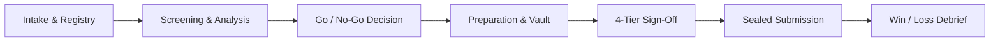

# TenderTracker Command Center — Customer & End-User Operating Manual
**Enterprise Bid Management, Tender Governance & Master Document Vault System**

*Version 2.4 | Production Release | Zero-Cloud Local-Vault Architecture*

---

## Table of Contents
1. [System Overview & Architectural Principles](#1-system-overview--architectural-principles)
2. [Global Layout & Navigation](#2-global-layout--navigation)
3. [Command Center Dashboard](#3-command-center-dashboard)
4. [Tender Pipeline & Active Bids](#4-tender-pipeline--active-bids)
5. [Tender Intake & Fast Registry](#5-tender-intake--fast-registry)
6. [Tender Workspace & 6-Gate Lifecycle](#6-tender-workspace--6-gate-lifecycle)
   - [Overview & Sentinel Cards](#61-overview--sentinel-cards)
   - [Requirements & Compliance Matrix](#62-requirements--compliance-matrix)
   - [Task Management Kanban](#63-task-management-kanban)
   - [Tender Document Vault](#64-tender-document-vault)
   - [JV & Partner Coordination](#65-jv--partner-coordination)
   - [Submission Ledger & Proof](#66-submission-ledger--proof)
   - [Outcome & Win/Loss Debrief](#67-outcome--winloss-debrief)
   - [Executive Summary Dossier](#68-formal-executive-summary-dossier)
7. [My Tasks Console](#7-my-tasks-console)
8. [Team Allocation & Workload Radar](#8-team-allocation--workload-radar)
9. [Calendar & Deadline Schedule](#9-calendar--deadline-schedule)
10. [Client Visitors & Meeting Hub](#10-client-visitors--meeting-hub)
11. [Master Document Vault & Reusable Libraries](#11-master-document-vault--reusable-libraries)
    - [Statutory & Corporate Credentials](#111-statutory--corporate-credentials)
    - [Company Past Projects & Credentials (WO & CC)](#112-company-past-projects--credentials-wo--cc)
    - [Default Tender Documents & Auto-Injection](#113-default-tender-documents--auto-injection)
12. [Corporate Entities & Company Profiles](#12-corporate-entities--company-profiles)
13. [Procuring Organizations Directory](#13-procuring-organizations-directory)
14. [Reports, Analytics & Win-Rate Ledger](#14-reports-analytics--win-rate-ledger)
15. [Team Collaboration & Channel Discussions](#15-team-collaboration--channel-discussions)
16. [Archived Tenders & Closed Pipeline](#16-archived-tenders--closed-pipeline)
17. [Partner Portal (Joint Venture Workspace)](#17-partner-portal-joint-venture-workspace)
18. [Settings, Storage Paths & Alerts](#18-settings-storage-paths--alerts)
19. [Security, Roles & Cryptographic Verification](#19-security-roles--cryptographic-verification)
20. [Frequently Asked Questions (FAQ)](#20-frequently-asked-questions-faq)

---

## 1. System Overview & Architectural Principles

TenderTracker Command Center is a high-reliability enterprise tender management platform designed for prime contractors, engineering firms, software consortiums, and procurement specialists.

### Core Operating Tenets:
1. **The 10-Second Rule**: Any executive or bid director must be able to gauge all overdue items, missing documents, and approaching deadlines within 10 seconds of landing on a screen.
2. **Segregation of Lifecycle Stage vs. Go/No-Go Decision**: Operational stages (`DISCOVERED`, `SCREENING`, `PREPARATION`, etc.) are tracked independently from the commercial Go/No-Go evaluation matrix.
3. **Zero-Cloud Local Storage Vault**: All tender documents, work orders, and completion certificates reside securely on your local SSD/HDD storage under `storage/tenders/{TDR-ID}/...` with automated SHA-256 cryptographic verification.
4. **Anti-Leakage Partner Isolation**: Joint Venture (JV) partners only see authorized credentials and folders, protecting internal lead bidder IP and cost sheets.

---

## 2. Global Layout & Navigation

### Layout Elements:
* **Left Navigation Sidebar**: Quick access to all modules grouped into **Core Workspaces** (Dashboard, Tenders, Registry, Tasks, Calendar, Reports, Notifications) and **Enterprise Master Libraries** (Document Vault, Credentials, Client Visits, Organizations, Company Profiles, Settings).
* **Global Header**:
  * **Search Bar** (`Ctrl + K`): Search across tender IDs, project titles, reference numbers, and procuring entities.
  * **Dual Timezone Clock**: Live real-time dual clocks for **BD Standard Time (BST)** and **UTC / Geneva** for international UN tenders.
  * **`+ New Tender` Quick Button**: Instant modal to register a new bid.
  * **Active User Profile & Role Switcher**: Quick toggle between System Admin, Bid Director, Technical Lead, and Financial Analyst roles.

---

## 3. Command Center Dashboard

**Route**: `/dashboard`  
**Purpose**: Executive mission control showing live bidding metrics, financial volume, approaching SLA deadlines, and urgent action items.

### Key Features & Walkthrough:
1. **Top KPI Metrics**:
   * **Active Bids**: Live count of ongoing tenders across all active stages.
   * **Pipeline Volume (BDT / USD)**: Aggregate commercial value with live foreign exchange conversion.
   * **Critical 48h Deadlines**: Countdown of tenders requiring immediate submission or schedule purchase.
   * **Readiness Score**: Average composite score across mandatory document checklists.
2. **Urgent Attention Sentinel**: Surfaces tenders with overdue milestone tasks, unverified statutory documents, or unassigned roles.
3. **Stage Breakdown Matrix**: Visual distribution across Discovered, Screening, Technical Preparation, Review, and Submitted.
4. **Active Tender Registry Table**: Interactive table with swapped columns (Title & Reference, SOW Portal badge, Value in BDT, Submission Countdown, and Readiness percentage). Click any row to enter that tender's dedicated workspace.

---

## 4. Tender Pipeline & Active Bids

**Route**: `/tenders`  
**Purpose**: Comprehensive catalog and filtering grid for all tenders currently in progress.

### Step-by-Step Instructions:
1. **Filter by Operational Stage**: Click the stage pill buttons (`All`, `Discovered`, `Screening`, `Preparation`, `Review`, `Submitted`) to isolate specific pipelines.
2. **Filter by Category / Portal**: Use the dropdown menus to filter by SOW Category (Software, Engineering, Heavy Machinery) or Procurement Portal (`e-GP`, `UNGM`, `UNDP`, `ADB`, `World Bank`).
3. **Search**: Type any keyword in the search bar to filter instantly by tender reference code or procuring authority.
4. **Open Workspace**: Click **"Open Tender Workspace"** on any tender card or table row to navigate to its detailed 6-gate management console.

---

## 5. Tender Intake & Fast Registry

**Route**: `/registry`  
**Purpose**: Rapid intake interface for onboarding new tender notices and generating formal executive dossiers.

### How to Register a New Tender:
1. Click **`+ New Tender`** in the global header or navigate to `/registry`.
2. **Fill Core Particulars**:
   * **Tender ID**: System-generated (e.g. `TDR-2026-RHD-001`) or custom reference.
   * **Title & Procuring Authority**: Full title of the RFP and purchasing agency (e.g., *Roads and Highways Department*).
   * **Category**: Select the appropriate scope of work category.
3. **Financials & Exchange Rate**:
   * Enter the estimated value and currency (e.g., USD, BDT, EUR).
   * When USD/EUR is chosen, the system automatically computes `Estimated Value (BDT)` based on real-time rates.
4. **Key Timeline Milestones**:
   * Schedule Purchase Deadline.
   * Pre-Bid Meeting Date & Location.
   * Final Submission Deadline.
5. **Auto-Provisioning**:
   * Upon clicking **"Save & Create Tender"**, the system automatically creates the local storage directory and attaches all **Default Mandatory Documents** configured in your Master Vault.

---

## 6. Tender Workspace & 6-Gate Lifecycle

**Route**: `/tenders/{id}`  
The Tender Detail Workspace is the core operational engine of TenderTracker, divided into 7 specialized functional tabs.

### 6.1 Overview & Sentinel Cards

* **Executive Summary**: High-level overview of scope, procurement method, and budget source.
* **Go/No-Go Decision Matrix**: Weighted criteria scorecard (Capability, Profitability, Risk, Strategic Fit) with overall recommendation.
* **Days & Hours Remaining Countdown**: Prominently displayed countdown timer to prevent missed deadlines.

---

### 6.2 Requirements & Compliance Matrix
**Route**: `/tenders/{id}/requirements`

* **Clause Extraction**: Lists all mandatory statutory, technical, and financial clauses parsed from the RFP.
* **Status Flags**: Mark clauses as `COMPLIANT`, `PARTIALLY_COMPLIANT`, or `NON_COMPLIANT`.
* **Evidence Linking**: Attach specific documents or page numbers directly to each requirement to guarantee 100% compliance during technical evaluation.

---

### 6.3 Task Management Kanban
**Route**: `/tenders/{id}/tasks`

* **Kanban Columns**: `To Do`, `In Progress`, `Under Review`, and `Completed`.
* **Assignee Allocation**: Assign tasks to specific team members (e.g., Tariqul, Sarah, Tanvir) with SLA due dates.
* **Pinned Footer Modal**: The task modal features pinned action buttons with a scrollable container to ensure fast entry on any screen resolution.

---

### 6.4 Tender Document Vault
**Route**: `/tenders/{id}/documents`

#### Standard Local Storage Folders:
1. `01_original_tender_documents`: Official RFP notices, amendments, drawings, and ToR.
2. `02_company_statutory_documents`: Lead bidder trade license, e-TIN, and tax clearance.
3. `02A_jv_partner_credentials` *(active in JV tenders)*: Partner incorporation certificates and authorization letters.
4. `03_technical_proposal`: Architecture diagrams, methodology, engineer CVs.
5. `04_financial_proposal`: Priced BOQ, bank guarantees, and commercial sheets.
6. `05_final_submission_package`: Sealed, signed PDF packages prepared for portal upload.
7. `06_submission_receipts`: Official portal submission slips and payment receipts.

#### Vault Actions:
* **Upload Document**: Direct upload to local SSD with instant SHA-256 calculation.
* **Link from Master Vault**: 1-click attachment of reusable corporate credentials without re-uploading.
* **Download Folder as ZIP**: Compiles all folder files along with an automated `VAULT_MANIFEST.txt` audit trail.

---

### 6.5 JV & Partner Coordination
**Route**: `/tenders/{id}/partners`

* **Consortium Configuration**: Assign lead bidder vs. JV partner equity share (e.g., 60% Lead / 40% Partner).
* **Power of Attorney (PoA) Tracking**: Monitor signed partner deeds and signatory authorizations.
* **Isolated Partner Folders**: Keep partner confidential files segregated from internal cost estimations.

---

### 6.6 Submission Ledger & Proof
**Route**: `/tenders/{id}/submission`

* **Pre-Submission Checklist**: Verification of all required seals, bank guarantees, and signatures.
* **Official Receipt Upload**: Attach portal confirmation PDF or screenshot.
* **Cryptographic Locking**: Freeze the tender records post-submission to prevent accidental alterations.

---

### 6.7 Outcome & Win/Loss Debrief
**Route**: `/tenders/{id}/result`

* **Award Result**: Mark tender as `AWARDED`, `DISQUALIFIED`, or `LOST`.
* **Winning Bidder Financial Analysis**: Record winning bidder name, quoted price, and variance percentage against your bid.
* **Debrief Notes & Lessons Learned**: Store institutional knowledge to improve win rates in subsequent bidding cycles.

---

### 6.8 Formal Executive Summary Dossier
**Route**: `/registry/summary/{id}`

* **3-Page Printable Executive Dossier**: Formatted for executive board review and physical tender committee meetings.
* **Includes**: Commercial terms, critical dates, financial solvency requirements, and risk summary.

---

## 7. My Tasks Console

**Route**: `/tasks/my-tasks`  
**Purpose**: Personalized task workstation aggregating all deliverables assigned to you across every active tender.

### Key Actions:
* **Priority Views**: Toggle between `Due Today`, `This Week`, and `Overdue`.
* **Direct Deep-Link**: Click any task title to jump straight into that tender's task kanban board.
* **Completion Toggle**: Check off deliverables in real-time.

---

## 8. Team Allocation & Workload Radar

**Route**: `/team`  
**Purpose**: Real-time capacity monitoring across technical writers, financial analysts, and bid managers.

### Features:
* **Workload Gauges**: View active tender counts per team member to prevent burnout.
* **Role Breakdown**: Clear division between Lead Bidder and JV Partner technical personnel.
* **Quick Task Reassignment**: Rebalance team assignments with drag-and-drop or dropdown reassignments.

---

## 9. Calendar & Deadline Schedule

**Route**: `/calendar`  
**Purpose**: Visual chronological radar for all critical procurement milestones.

### Highlights:
* **Color-Coded Event Tags**:
  * 🟡 **Schedule Purchase Deadlines**: Last date to buy tender documents.
  * 🔵 **Pre-Bid Clarification Meetings**: Physical or virtual alignment sessions.
  * 🔴 **Submission Deadlines**: Hard cut-off timestamps for proposal uploads.
* **Multi-View Modes**: Switch between Month, Week, and Agenda timeline modes.

---

## 10. Client Visitors & Meeting Hub

**Route**: `/clients/visits`  
**Purpose**: Tracking all physical office visits, pre-bid conferences, and commercial negotiations with client delegations.

### Managing Client Engagements:
1. **Schedule a Visit**: Click **"+ Schedule Client Visit"**.
2. **Enter Visitor Particulars**: Client organization (e.g., *UNDP*, *Bangladesh Railway*), visitor names, designations, and contact details.
3. **Log Meeting Outcomes**:
   * Record **Minutes of Meeting (MoM)**.
   * Track assigned follow-up action items with due dates.
   * Document client sentiment rating (*Positive*, *Neutral*, *Concerning*).

---

## 11. Master Document Vault & Reusable Libraries

**Route**: `/documents`  
The Master Document Vault eliminates repetitive file uploads by maintaining a centralized, verified corporate repository.

---

### 11.1 Statutory & Corporate Credentials
**Tab**: `Statutory & Master Documents` (`/documents`)

* **Upload Once, Use Everywhere**: Store Trade Licenses, e-TINs, Tax Returns, and ISO Certificates.
* **Tiered Access Control**: Restrict sensitive documents to `ALL_TEAM`, `MANAGEMENT_ONLY`, `RESTRICTED_FINANCE`, or `EXECUTIVE_ONLY`.
* **In-Browser Document Preview**: View PDFs, Word documents, and spreadsheets directly without downloading.
* **Quick Star (⭐) Toggle**: Click the star icon to immediately flag any document as a default requirement for all bids.

---

### 11.2 Company Past Projects & Credentials (WO & CC)
**Tab**: `Past Projects & Work Orders (WO & CC)` (`/documents?tab=credentials`)

* **Software Project Repository**: Store comprehensive past contract credentials (e.g., *Enterprise Data Warehouse*, *Microgrid SCADA System*).
* **Work Order (WO) & Completion Certificate (CC)**:
  * Dedicated upload boxes with automated **SHA-256 checksums**.
  * Instant status badges: Attached vs. Pending Upload.
* **Dynamic Custom Fields**: Add key-value pairs for Tech Stack (`React, FastAPI, PostgreSQL`), Architecture, SLA guarantees, or Team Size.
* **1-Click Clipboard Copy**: Copy formatted project citations into technical proposal documents.
* **"Use in Tender" Button**: Directly link project credentials and attached certificates into any active tender's submission folder.

---

### 11.3 Default Tender Documents & Auto-Injection
**Tab**: `Default Tender Documents` (`/documents?tab=defaults`)

* **Automatic Provisioning**: Any document configured here is **automatically linked into every new tender upon creation**.
* **Configurable Target Folders**: Specify which folder the document lands in (e.g., `02_company_statutory_documents` or `03_technical_proposal`).
* **Auto-Inject Toggle**: Turn auto-injection `ON` or pause it with a single click.
* **⚡ Sync to Active Tenders**: Click this button to backfill default credentials across all existing active tenders.

---

## 12. Corporate Entities & Company Profiles

**Route**: `/tools/company-profiles`  
**Purpose**: Central command repository for corporate identities, statutory tax credentials, banking solvency, and dynamic bidding metadata.

### Managing Entities:
* **Multi-Company Management**: Manage Lead Bidders (*PrimeTech Ltd*, *NYK Advance Limited*), JV Partners (*Meghna Data Systems*, *Kestrel*), and Subcontractors.
* **Tabbed Profile Console**:
  1. **Overview & Identity**: Legal names, registration numbers, country, and status.
  2. **Statutory & Tax**: e-TIN, BIN/VAT, Trade License numbers and expiry dates.
  3. **Banking & Financials**: Bank solvency lines, 3-year audited turnover (BDT & USD), routing numbers, and credit ratings.
  4. **Accreditations & Workforce**: Total employees, certified engineers, and ISO credentials.
  5. **Dynamic Custom Fields**: Unlimited custom corporate attributes.
  6. **Linked Credentials & Vault Docs**: Verified summary of all past project credentials and master vault files associated with the entity.

---

## 13. Procuring Organizations Directory

**Route**: `/tools/organizations`  
**Purpose**: Directory of government ministries, directorates, and multilateral purchasing authorities.

* **Entity Hierarchy**: Track parent ministries and subordinate directorates (e.g., *Ministry of Road Transport and Bridges* &rarr; *RHD*).
* **Portal Endpoints**: Direct links to client procurement portals (`e-GP`, `UNGM`, `UNDP`, `BRAC`).
* **Tender History**: One-click lookup of all historical tenders issued by that specific organization.

---

## 14. Reports, Analytics & Win-Rate Ledger

**Route**: `/reports`  
**Purpose**: Executive visual analytics reporting win/loss ratios, financial conversion, and portal distribution.

* **Conversion Rate Metrics**: Track proposal-to-award conversion efficiency.
* **Multi-Criteria Filter Toolbar**: Filter reports by Date Range, Stage, Category, and Organization.
* **Exportable Data**: Export filtered analytics tables for senior board review.

---

## 15. Team Collaboration & Channel Discussions

**Route**: `/discussions`  
**Purpose**: Real-time cross-functional chat for technical architects, proposal writers, and financial estimators.

* **Department Channels**: Dedicated channels for `#technical-bids`, `#financial-estimating`, `#statutory-compliance`, and `#general`.
* **Tender Context Linking**: Tag specific tender IDs (`TDR-2026-RHD-001`) in chat messages for instant proposal context.

---

## 16. Archived Tenders & Closed Pipeline

**Route**: `/tools/archive`  
**Purpose**: Repository of non-participating, declined, cancelled, or archived bids.

* **Reason Code Tracking**: Record why a tender was declined (*Unfavorable Commercial Terms*, *Short Deadline*, *Lack of Eligibility*).
* **Restore Capability**: Un-archive any tender back to the active pipeline if the client extends the deadline or issues an addendum.

---

## 17. Partner Portal (Joint Venture Workspace)

**Route**: `/tools/partner-portal`  
**Purpose**: Dedicated portal for external consortium members and JV partners.

* **Strict Scope Isolation**: Restricts partner view strictly to their assigned deliverables and folders.
* **Document Upload & Handover**: Partners can upload statutory documents directly into `02A_jv_partner_credentials` without accessing lead bidder internal files.

---

## 18. Settings, Storage Paths & Alerts

**Route**: `/settings`  
**Purpose**: System infrastructure configuration, local SSD vault paths, and SLA alert thresholds.

* **Storage Root Path**: Configurable local SSD path (e.g., `H:/Tender tracker v2/storage/tenders`).
* **Cryptographic Verification**: Toggle mandatory SHA-256 hash checks upon file ingestion.
* **SLA Alert Threshold**: Configure deadline warning alerts (e.g., 48 hours prior to submission).
* **SMTP Gateway Configuration**: Set up internal SMTP server credentials for automated email dispatch.

---

## 19. Security, Roles & Cryptographic Verification

TenderTracker enforces enterprise-grade security protocols:
* **Role-Based Access Control (RBAC)**:
  * **System Administrator**: Full configuration, storage path management, and user provisioning.
  * **Bid Director**: Executive sign-offs, Go/No-Go decisions, and submission locks.
  * **Technical / Financial Lead**: Document preparation, task assignment, and compliance matrix updates.
  * **Tender Analyst**: Read-only evaluation and RFP analysis.
* **Cryptographic Data Integrity**: Every document uploaded is hashed with **SHA-256** upon receipt. Any tampering with physical files on disk triggers an integrity mismatch alert.

---

## 20. Frequently Asked Questions (FAQ)

### Q1: Where are files stored? Are they uploaded to the cloud?
**A**: No cloud object storage is used. All files are securely stored on your local SSD/HDD filesystem under `storage/tenders/{TDR-ID}/...`. Your confidential proposals, pricing sheets, and company credentials remain strictly within your local corporate network.

### Q2: How do I attach a Work Order (WO) or Completion Certificate (CC) to a past project?
**A**: Navigate to **Document Vault** (`/documents`) &rarr; click the **"Past Projects & Work Orders (WO & CC)"** tab. Under your project card, click **"Upload Work Order PDF"** or **"Upload Completion Certificate PDF"**. The file is stored with an automated SHA-256 hash stamp.

### Q3: How do I ensure certain documents are automatically added to all new tenders?
**A**: Navigate to **Document Vault** (`/documents`) &rarr; click **"Default Tender Documents"**. Add your mandatory documents (or pick them from your existing vault) and assign their target folder (e.g., `02_company_statutory_documents`). Ensure the status is set to **Auto-Inject ON**.

### Q4: Can I download all files for a tender at once?
**A**: Yes. In any tender's **Documents** tab, you can click **"Download All as ZIP"** or download individual folders as ZIP archives. Every archive automatically includes an audit manifest (`VAULT_MANIFEST.txt`).

---

*TenderTracker Command Center © 2026. Built for Precision, Security, and Maximum Bid Conversion.*

